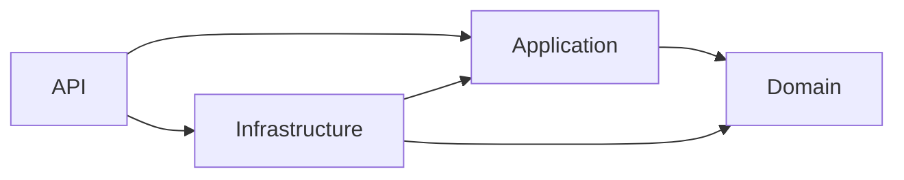

# Japanese Learning User Service

The .NET backend submodule of the Japanese Learning application provides account registration, login, access and refresh tokens, and claim-based user identity. Angular is the frontend; Quarkus owns vocabulary, flashcards, and the API Gateway. This repository contains the user service, not those clients or services.

Implemented capabilities include active-user checks, User/Admin roles, RS256 access tokens, refresh-token rotation and logout, public JWKS, SQL Server persistence, structured logs, health probes, and Prometheus metrics. Email verification, password reset, account/profile editing, role administration, and OpenID Connect discovery are not implemented.

## Technology stack

Versions below come from the project files and Dockerfile.

| Area | Implementation |
| --- | --- |
| Runtime | .NET / ASP.NET Core 9; all projects target `net9.0` |
| Language | C# SDK default for .NET 9 (C# 13); nullable references and implicit usings enabled |
| Application pipeline | MediatR 14.2.0; FluentValidation 12.1.1 |
| Persistence | SQL Server; Dapper 2.1.79; Microsoft.Data.SqlClient 7.0.2; stored procedures |
| Security | JwtBearer 9.0.8; Identity password hashing via Microsoft.Extensions.Identity.Core 9.0.17; Microsoft IdentityModel JWT APIs; .NET RSA/SHA-256 |
| API documentation | Swashbuckle.AspNetCore 9.0.6 |
| Observability | Serilog.AspNetCore 9.0.0, Serilog.Sinks.File 7.0.0, prometheus-net.AspNetCore 8.2.1 |
| Tests | xUnit 2.9.2, Moq 4.20.72, Microsoft.NET.Test.Sdk 17.12.0, coverlet.collector 6.0.2 |
| Packaging | Multi-stage Docker build with digest-pinned .NET 9 SDK and ASP.NET runtime images |

There is no `global.json`, explicit `LangVersion`, Entity Framework Core, or full ASP.NET Core Identity account store. The SQL Server and Flyway versions are not pinned in this submodule.

## Architecture

The solution uses four layers with dependencies pointing toward Application and Domain:



- **API:** controllers, HTTP contracts, bearer authentication, authorization, exception handling, correlation, Swagger, metrics, and health endpoints.
- **Application:** feature-oriented MediatR commands, handlers, validators, responses, and persistence/security interfaces.
- **Domain:** user and refresh-token entities and the User/Admin role enum; no project dependencies.
- **Infrastructure:** Dapper repositories, SQL connections, password hashing, token generation, RSA loading, current-user claims, and SQL health checks.

Startup calls `AddApplication` and `AddInfrastructure` to register implementations with dependency injection. Authentication commands flow through controller `ISender` → validation behavior → logging behavior → handler → repository/security abstractions. Repositories pass cancellation tokens to asynchronous Dapper operations. The `me` and `admin-test` endpoints read authenticated claims directly.

## Prerequisites

- Git and a .NET 9 SDK.
- A reachable SQL Server instance and an existing application database with the migrations applied.
- A matching, unencrypted RSA PEM key pair of at least 2048 bits, readable by the service.
- A trusted ASP.NET Core development HTTPS certificate for the HTTPS launch profile.
- Docker with Linux containers only if using the supplied Dockerfile.
- An externally configured Flyway runner for database migrations.

## Getting started

Use the .NET checkout supplied by your parent application repository. Run the following commands from the directory containing `JapaneseLearning.User.sln`:

```powershell
dotnet --list-sdks
dotnet restore JapaneseLearning.User.sln
```

1. Start SQL Server through your development environment and create/select the application database.
2. Apply all scripts in `db/migration` through the environment's Flyway runner before using authentication endpoints. See [Database and persistence](#database-and-persistence).
3. Supply database configuration and readable RSA key paths as described below.
4. Run the API:

```powershell
dotnet run --project src/JapaneseLearning.User.Api --launch-profile https
```

The `https` profile sets Development and binds `https://localhost:7066` and `http://localhost:5116`. The `http` profile binds only `http://localhost:5116`. HTTPS redirection is enabled by default; for intentional HTTP-only local development, set `$env:Http__RedirectToHttps = 'false'` before using that profile.

With the HTTPS profile:

- Swagger UI: https://localhost:7066/swagger
- OpenAPI JSON: https://localhost:7066/swagger/v1/swagger.json
- Public signing key: https://localhost:7066/.well-known/jwks.json
- Readiness: https://localhost:7066/health/ready

A successful liveness response does not establish database readiness or migration completeness.

## Environment configuration

The API uses ASP.NET Core configuration: `appsettings.json`, environment-specific JSON, environment variables, and command-line overrides. Environment variables use double underscores for nested keys, for example `Jwt__Issuer`. No `UserSecretsId` is configured in the API project.

`src/JapaneseLearning.User.Api/appsettings.json` supplies shared defaults. `appsettings.Development.json` supplies local key paths and application Debug logging. There is no Production-specific settings file; production must supply database credentials and RSA settings externally. Keep credentials and private keys outside Git and image build arguments.

### Database settings

Choose **one** configuration mode:

| Setting | Meaning |
| --- | --- |
| `Database:ConnectionString` | Complete SQL Server connection string; empty by default |
| `Database:Server`, `Database:Name`, `Database:User`, `Database:Password` | Alternative split configuration; all four are required |
| `Database:TrustServerCertificate` | Split-mode certificate trust override; defaults to false |

A complete connection string must identify the server and database and provide appropriate authentication. Windows integrated authentication is supported through the complete connection-string mode. Mixing a nonempty connection string with split credentials fails startup. The application forces `PersistSecurityInfo=false`.

For a local Windows SQL Server configured to accept your Windows identity, this credential-free example can be adapted:

```powershell
$env:Database__ConnectionString = 'Server=localhost;Database=JapaneseLearningUser;Integrated Security=True;TrustServerCertificate=True'
```

`JapaneseLearningUser` is an example database name, not a hard-coded requirement. The certificate trust override above is for local development; use properly validated SQL Server certificates in deployment. Supply SQL credentials through your environment's secret mechanism without printing the resulting connection string.

### JWT settings

| Setting | Default / requirement |
| --- | --- |
| `Jwt:PrivateKeyPath` | Required signing PEM path; blank in base settings |
| `Jwt:PublicKeyPath` | Required matching validation PEM path; blank in base settings |
| `Jwt:KeyId` | Required; 1–128 ASCII letters, digits, hyphens, or underscores |
| `Jwt:Issuer` | `JapaneseLearning.User` |
| `Jwt:Audience` | `JapaneseLearning` |
| `Jwt:AccessTokenExpirationMinutes` | 15; allowed range 1–1440 |
| `Jwt:RefreshTokenExpirationDays` | 7; allowed range 1–365 |

Issuer and audience must be nonblank, at most 256 characters, and contain no control characters. `Jwt:Secret` is not used.

Development defaults are `../../../secrets/jwt/private.pem`, `../../../secrets/jwt/public.pem`, and key ID `japanese-learning-local-1`. Paths resolve relative to the application's **content root**, normally `src/JapaneseLearning.User.Api`, so these defaults point to `secrets/jwt` in the parent of this .NET checkout. Obtain the pair from your environment provisioning, or override with absolute paths:

```powershell
$env:Jwt__PrivateKeyPath = 'C:/secure/japanese-learning/private.pem'
$env:Jwt__PublicKeyPath = 'C:/secure/japanese-learning/public.pem'
$env:Jwt__KeyId = 'japanese-learning-local-1'
```

The loader imports PKCS#8/PKCS#1 private PEM and SubjectPublicKeyInfo/PKCS#1 public PEM, verifies key size and pairing, and loads keys once before serving HTTP. Missing/unreadable files, encrypted or invalid PEM, mismatched keys, and invalid options stop startup. Restart after changing keys or token settings. Automatic key rotation and overlapping published keys are not implemented.

### Other settings

- `Http:RedirectToHttps`: defaults to true in startup code; the Docker image sets it to false.
- `AllowedHosts`: `*` in base settings.
- `Serilog` and `LogFiles`: see [Logging and observability](#logging-and-observability).
- No Angular origin, Quarkus URL, gateway URL, CORS policy, or outbound service client is configured here.

## Project structure

```text
JapaneseLearning.User.sln
src/
  JapaneseLearning.User.Api/
    Authentication/       JWT bearer validation
    Controllers/          Authentication and JWKS endpoints
    Common/               Errors, response types, correlation and logging
    Health/               Liveness/readiness mappings
    Observability/        Prometheus metrics
    Properties/           Local launch profiles
    Program.cs            Composition and middleware
    appsettings*.json     Shared and development settings
  JapaneseLearning.User.Application/
    Abstractions/         Persistence and security interfaces
    Auth/                 Register, Login, Refresh, Logout use cases
    Common/               Pipeline behaviors and application exceptions
  JapaneseLearning.User.Domain/
    Entities/             User, refresh token, and roles
  JapaneseLearning.User.Infrastructure/
    Configuration/        Database and JWT options
    Database/             SQL connection factory
    Persistence/          Dapper repositories
    Security/             Password hashing, tokens, RSA keys, claims
    HealthChecks/         SQL connectivity check
db/migration/             Versioned SQL migrations V1–V4
tests/JapaneseLearning.User.UnitTests/
    Security/             JWT, JWKS, key startup, database options
    Logging/              Correlation, safe logs, authentication events
    Health/               Probe behavior
    Observability/        Metrics behavior
Dockerfile
.dockerignore
```

See [AGENTS.md](AGENTS.md) for repository contribution and architectural conventions.

## Authentication and authorization

### Account and token flow

1. **Register:** accepts username, email, and password. Username is required and limited to 100 characters; email must be valid and at most 255 characters; password length is 8–100. The handler trims usernames, trims/lowercases email, checks uniqueness, hashes the password, and creates an active `User` account. Registration returns account metadata, not tokens. There is no activation/email-verification step.
2. **Login:** normalizes email, retrieves the user, rejects inactive accounts, and verifies the password. The service uses ASP.NET Core Identity's `PasswordHasher<object>` behind its own abstraction. A verification result requesting rehash is accepted, but the hash is not updated automatically. Successful login returns `accessToken`, `refreshToken`, and `expiresIn` in seconds.
3. **Refresh:** accepts a refresh token in the JSON body, checks its hash, revocation, expiration, and active user, then revokes it and persists a newly generated token. The response contains a new access/refresh pair with a fresh configured lifetime.
4. **Logout:** accepts a refresh token in the JSON body and revokes that token. Missing, expired, or already revoked tokens return 401. It does not revoke other sessions or invalidate already issued access tokens.

Refresh tokens contain 64 cryptographically random bytes encoded as Base64. Only their SHA-256 hex hashes are stored in SQL Server, with user ID, creation, expiration, and revocation timestamps. Raw tokens are returned to the caller.

**Rotation limitation:** checking, revoking, and inserting tokens are separate database operations without a shared transaction or atomic consume operation. Concurrent refresh requests are not guaranteed to produce only one successor; an insertion failure after revocation can require a new login. There is no token-family reuse detection or automatic expired-token cleanup.

### Access tokens and roles

Access tokens use **RS256**, a configured `kid` header, and claims `sub` (user GUID), `unique_name`, `email`, `role`, `jti`, `iss`, `aud`, and `exp`. Each issued token has a new `jti`.

Bearer validation requires a signed, unexpired token with the configured issuer, audience, public signing key, and RS256 algorithm. Clock skew is zero. Standard inbound claim mapping supplies `ICurrentUser` with user ID, username, email, and role.

- `GET /api/auth/me` requires authentication and returns claims, without reloading the account.
- `GET /api/auth/admin-test` requires the `Admin` role.
- Registration always assigns `User`; there is no role-management endpoint or admin seeding migration.
- Register, login, refresh, and logout do not require an access token. Refresh/logout rely on possession of the refresh token.
- Account status and role changes are not rechecked on ordinary bearer requests; existing claims remain effective until token expiry.

### Angular and Quarkus integration boundary

Clients can log in through the JSON API and send `Authorization: Bearer <access-token>` on protected requests. Refresh/logout bodies use `{ "refreshToken": "<refresh-token>" }`. This service does not issue authentication cookies or implement frontend token storage.

Anonymous `GET /.well-known/jwks.json` publishes one public RSA signing key as `keys[]`, with `kty`, `use`, `alg`, `kid`, `n`, and `e`. It exposes no private key material and does not reread files per request.

The JWKS endpoint provides the public-key contract for Quarkus/gateway verifiers. Such consumers must enforce signature, issuer, audience, expiration, and their own authorization rules; they do not need the private signing key. Actual gateway routing, JWKS caching, Quarkus role mapping, Angular token handling, and browser cross-origin behavior are outside this repository and cannot be established from this submodule.

## Database and persistence

SQL Server stores:

- **Users:** identity, unique username/email, password hash, role, active status, and timestamps.
- **RefreshTokens:** hashed tokens linked to users, expiry, and optional revocation time.

Dapper repositories call parameterized `dbo.usp_Users_*` and `dbo.usp_RefreshTokens_*` stored procedures. Each operation opens its own connection. There is no EF Core migration tooling or Unit of Work implementation.

Apply the Flyway-style scripts in order:

| Migration | Purpose |
| --- | --- |
| `V1__create_users_table.sql` | Users and uniqueness indexes |
| `V2__create_user_stored_procedures.sql` | User creation and existence checks |
| `V3__create_refresh_tokens.sql` | Refresh tokens, token procedures, user lookup procedures |
| `V4__add_user_role.sql` | Roles and updated user procedures |

The database must already exist. Point the environment's Flyway SQL location at this checkout's `db/migration` and target the same database as the API. Apply through V4 before running account operations. The API and Docker image do not execute migrations.

**Migration setup gap:** this submodule has no Flyway executable/version, connection configuration, Compose service, or migration wrapper. Obtain the exact invocation and infrastructure startup commands from the parent environment; no repository-specific migration command can be verified here. Do not use `dotnet ef database update`. Add new versioned migrations rather than editing applied ones.

## API documentation

Swagger UI is at `/swagger`, with JSON at `/swagger/v1/swagger.json`. In the current source, Swagger is enabled in **all environments** because its Development guard is commented out.

| Endpoint | Access | Success |
| --- | --- | --- |
| `POST /api/auth/register` | Anonymous | 201, account metadata |
| `POST /api/auth/login` | Anonymous | 200, token pair and expiry seconds |
| `POST /api/auth/refresh` | Refresh token in body | 200, replacement token pair |
| `POST /api/auth/logout` | Refresh token in body | 204, no body |
| `GET /api/auth/me` | Bearer token | 200, current identity claims |
| `GET /api/auth/admin-test` | Bearer token with Admin role | 200, role-check response |
| `GET /.well-known/jwks.json` | Anonymous | 200, public JWKS |

Use Swagger to register with `username`, `email`, and `password`, then log in with `email` and `password`. Enter the access token in Swagger's **Authorize** control before calling `me`. Swagger declares a global Bearer security requirement, although the server permits the anonymous operations listed above.

## Error handling and responses

Successful authentication endpoints return their response objects directly in camelCase; they are **not** wrapped in `ApiResponse<T>`. Logout returns no body. JWKS, health checks, and metrics retain their own formats.

Centralized exception handling maps validation failures to 400, authentication failures to 401, forbidden access to 403, missing resources to 404, conflicts to 409, and unexpected exceptions to a generic 500. Empty error statuses are also given a common JSON response.

Error envelopes contain `success: false`, `error` with `code`, `message`, optional field `details`, and `traceId`. Null properties may be omitted for MVC responses; clients should not depend on their presence. FluentValidation errors contain field details, while malformed/model-binding failures use a generic validation message. Unexpected errors do not expose exception messages or stack traces.

`traceId` in the error envelope is the correlation ID returned in `X-Correlation-ID`. It is distinct from the distributed Activity trace ID used in logs.

## Logging and observability

Serilog writes newline-delimited JSON to console and rolling files, while application code uses `ILogger<T>`. A bootstrap logger captures startup failures. Events include service/environment, correlation, Activity trace/span IDs when present, structured request completion, MediatR timing, and authentication outcomes.

The middleware accepts a single `X-Correlation-ID` containing 1–64 ASCII letters, digits, underscores, or hyphens; otherwise it creates one. Request logs omit query strings, headers, and bodies. Safe exception diagnostics retain selected types/frames and SQL error metadata while excluding arbitrary messages and data. Do not add credentials, tokens, hashes, private keys, or authentication payloads to logs; the formatter is not a general secret scanner.

| Configuration key | Default |
| --- | --- |
| `LogFiles:Directory` | `logs`, relative to process working directory |
| `LogFiles:RetentionDays` | 30 |
| `LogFiles:FileSizeLimitBytes` | 104857600 (100 MiB) |
| `LogFiles:RetainedFileCountLimit` | 300 |
| `Serilog:MinimumLevel:Default` | `Information` |
| `Serilog:MinimumLevel:Override:JapaneseLearning.User` | `Information`; `Debug` in Development |

Files use `user-api-YYYYMMDD.json`, with suffixes for size rolls. Age and count limits both apply; high volume can shorten retained history. Retention is applied on file opening/rolling, not by a background cleanup service. Restart after changing file settings. Microsoft/System levels default to Warning, with hosting lifecycle events at Information.

Anonymous operational endpoints:

- `/health/live`: HTTP liveness without database access.
- `/health/ready` and `/health`: SQL connection readiness with a three-second check timeout; 200 `Healthy` or 503 `Unhealthy`. They do not verify tables, stored procedures, or migration versions.
- `/metrics`: Prometheus exposition with .NET runtime statistics and request count, duration, and in-progress metrics. Request labels use bounded method/route categories and status codes; health traffic is excluded.

No Prometheus server, dashboards, external log collector, or distributed-tracing exporter is configured in this submodule.

## Available commands

Run from the .NET repository root. These are source-checked commands; their presence is not a claim that a build or deployment has been executed.

```powershell
# Solution-level
dotnet restore JapaneseLearning.User.sln
dotnet build JapaneseLearning.User.sln -c Release --no-restore
dotnet test JapaneseLearning.User.sln -c Release --no-build

# API only
dotnet run --project src/JapaneseLearning.User.Api --launch-profile https
dotnet publish src/JapaneseLearning.User.Api/JapaneseLearning.User.Api.csproj -c Release -o artifacts/publish

# Test project only (builds as needed)
dotnet test tests/JapaneseLearning.User.UnitTests/JapaneseLearning.User.UnitTests.csproj

# Optional coverage collection using the referenced collector
dotnet test tests/JapaneseLearning.User.UnitTests/JapaneseLearning.User.UnitTests.csproj --collect:"XPlat Code Coverage"

# Container build
docker build -t japanese-learning-user:local .
```

The solution test command using `--no-build` assumes the preceding Release build succeeded. Migration commands depend on the external runner described above.

## Testing

`JapaneseLearning.User.UnitTests` contains xUnit tests with Moq boundary substitutes. Coverage includes JWT claims and rejection rules, RSA startup validation, JWKS exposure, database option validation, authentication events, correlation/error handling, log formatting/retention, health failure/recovery, and metrics.

Despite the project name, some tests start local HTTP hosts on ephemeral loopback ports. Tests require temporary-file and loopback access. RSA fixtures create disposable keys in the OS temporary directory; SQL dependencies are mocked. There is no separate integration-test project or live SQL migration/repository test suite.

The Coverlet collector is referenced and supports the optional command above. No coverage threshold, HTML reporting pipeline, or CI coverage gate is configured here.

## Build and deployment

The publish command creates a framework-dependent deployment requiring the ASP.NET Core 9 runtime. Run `dotnet JapaneseLearning.User.Api.dll` from the publish directory with database and JWT settings supplied. Launch profiles apply to local `dotnet run`, not published deployments.

The Dockerfile restores, builds, and publishes the API, then copies only published output into an ASP.NET Core 9 runtime image. It runs as the image's non-root `app` user via `APP_UID`, listens on HTTP port 8080, sets Production, disables HTTPS redirection, and includes curl. TLS termination belongs in the deployment gateway for this configuration.

Example standalone PowerShell invocation, after setting `Database__ConnectionString` securely in the host environment:

```powershell
docker run --rm --name japanese-learning-user -p 8080:8080 `
  --env Database__ConnectionString `
  --env Jwt__PrivateKeyPath=/app/secrets/jwt/private.pem `
  --env Jwt__PublicKeyPath=/app/secrets/jwt/public.pem `
  --env Jwt__KeyId=japanese-learning-local-1 `
  --mount "type=bind,source=C:/secure/japanese-learning,target=/app/secrets/jwt,readonly" `
  --mount "type=volume,source=japanese-learning-user-logs,target=/app/logs" `
  japanese-learning-user:local
```

Replace the host key directory with the provisioned directory containing the matching PEM files and grant the container user read/traversal permissions. The SQL hostname must be reachable from the container; `localhost` refers to the container itself. Issuer, audience, and lifetimes retain base defaults unless overridden.

The image creates writable `/app/logs`; use a persistent volume for retained logs and separate storage per replica. `.dockerignore` excludes key/secret files, environment-specific settings, tests, migrations, and generated output. Keys are mounted at runtime, not baked into the image.

Valid database options and RSA keys are required before HTTP starts. A later SQL outage makes readiness fail while liveness remains available. The Dockerfile has no `HEALTHCHECK`; configure readiness probing in orchestration. No Docker Compose or CI/CD workflow is present in this submodule.

## Troubleshooting

| Symptom | Check |
| --- | --- |
| Startup rejects database configuration | Choose complete connection string or all split settings, not both; include server, database, and valid authentication |
| Startup rejects JWT configuration | Check key paths relative to content root, permissions, unencrypted PEM, matching pair, minimum 2048-bit size, key ID, and lifetime ranges |
| Readiness is 503 | Check SQL reachability, database existence, credentials, and certificate trust; liveness does not test SQL |
| Readiness is healthy but account operations fail | Verify all V1–V4 migrations and stored procedures are present in the configured database |
| Protected endpoint returns 401 | Check Bearer header, RS256 signature, issuer/audience, expiry, and clocks; there is no clock-skew allowance |
| Admin endpoint returns 403 | Registration creates User accounts; the access token must carry Admin |
| Refresh/logout returns 401 | The token may be unknown, expired, or already revoked; refresh also requires an active account |
| HTTPS profile cannot start or browser rejects certificate | Check the local development certificate and availability of ports 7066/5116 |
| Browser cannot call the service across origins | No CORS middleware is configured here; confirm the parent application's gateway/proxy arrangement |
| Build cannot target the framework | Check `dotnet --list-sdks` for a .NET 9 SDK; this submodule does not pin an SDK patch |
| Container cannot read keys or write logs | Check runtime mounts and permissions for the non-root app user |

Environment-specific SQL/Flyway versions, infrastructure startup commands, key provisioning, gateway routing, and frontend integration must be confirmed in the parent application repository.